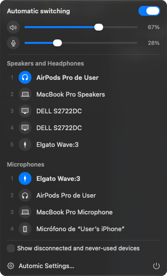

# Automic

A macOS menu bar app that keeps your microphone and speakers on the device you prefer. Rank your outputs and inputs once; whenever a device connects or disconnects, Automic makes the highest-ranked connected one the system default. Plug in the work headset and it wins, unplug it and the next device in the list takes over, at home or at the office, with no profiles to switch.

Nothing leaves your Mac, and Automic needs no permissions: it changes the default devices and never opens an audio stream.

<p align="center"></p>

## Features

- **Menu bar panel:** click the icon (a microphone with sound waves) for the **Automatic switching** switch, volume sliders for the current output and input, and both rankings: **Speakers and Headphones** and **Microphones**. The device in use has a blue badge. Click a device to use it now, drag it onto another row to take that row's place, or right-click for Use Now, Move to Top, Move Up, Move Down, Never Use Automatically and Forget Device. **Show disconnected and never-used devices** lists the rest, with when each was last seen.
- **Settings** (**Automic Settings…** in the panel, Command-comma while it is open) has the same rankings as full lists, plus launch at login and updates.
- **Disconnected devices are remembered** with their rank, by CoreAudio device UID, which stays the same across reconnects.
- **New devices join at the bottom**, so a device never takes over until you move it up. On the very first launch the current default devices go to the top, so installing Automic changes nothing.
- **Never Use Automatically** for devices that should only ever be picked by hand: monitor speakers, the iPhone microphone, virtual devices from meeting apps. **Forget Device** removes a disconnected one.
- **Picks by hand are respected:** choose a device in Automic's panel, Control Center or Sound settings and Automic keeps it until the next device connects or disconnects, then the ranking applies again. A hand next to the device in use marks a pick by hand being kept.
- **macOS's own switching is overruled:** macOS moves the default to a newly connected device (AirPods taking over the microphone, typically). A default change within 3 seconds of a device change counts as that, not as a pick by hand, and the ranking is applied again on a fresh device list.
- **Pause everything** with the **Automatic switching** switch; the menu bar icon dims while it is off.
- **Launch at login** in Settings > General.
- **Updates** in place with [Sparkle](https://sparkle-project.org).

## Requirements

- macOS 26 or later.
- Xcode with Swift 6.2 or later (developed with Swift 6.4).
- For `make dist`: [dmgbuild](https://github.com/dmgbuild/dmgbuild), `pipx install dmgbuild` (CI's pinned versions are in `.github/dmg-requirements.txt`).

## Build and run

```sh
make app        # release build, assembles and signs build/Automic.app
make run        # make app, quit a running copy, open the new one
make install    # copy to ~/Applications/Automic.app
make test       # unit tests (Swift Testing)
make dist       # zip, dmg and SHA256SUMS of build/Automic.app in build/dist
make appcast    # sign the zip and write build/dist/appcast.xml, the update feed
make signing-identity  # once: the self-signed identity releases and local builds sign with
make clean      # remove .build and build
```

Install to `~/Applications` before turning on **Launch at login**: the login item points at the app's current location.

### Signing

Automic needs no privacy permissions, so an ad-hoc signature works. A stable one still helps: macOS then recognizes every build and update as the same app, for the login item and for Gatekeeper's one-time Open Anyway.

`make signing-identity` makes a self-signed "Automic Code Signing" identity valid for 20 years, with no Apple account. It stores it in the `MACOS_CERTIFICATE_P12` and `MACOS_CERTIFICATE_PASSWORD` repository secrets (needs `gh auth login`), so releases are signed with it, and imports it into the login keychain, so local builds sign the same way. The first local build may ask to let `codesign` use the key: choose Always Allow. Back the identity up from Keychain Access. The target refuses to replace an existing identity, in the keychain or in the secrets, so run it once, on one Mac.

`make app` signs with "Automic Code Signing" if the keychain has it, else with the first "Apple Development" identity, else ad-hoc. Override with `make app SIGN_IDENTITY=-` (ad-hoc) or any identity hash from `security find-identity -p codesigning`.

A signature without a team ID, ad-hoc or self-signed, gets `Resources/AdHoc.entitlements`, which adds `com.apple.security.cs.disable-library-validation`: the hardened runtime would otherwise refuse to load the embedded Sparkle.framework. Builds signed with an Apple identity get `Resources/Automic.entitlements`, which is empty.

## Updates

Automic checks `appcast.xml` on the latest GitHub release (`SUFeedURL` in `Resources/Info.plist`) once a day and on **Check for Updates…**, with Sparkle's standard windows. As a menu bar app it opts into Sparkle's gentle reminders: a scheduled update shows the Dock icon and comes to the front instead of opening behind other windows. **Check for updates automatically** is in Settings > General.

Sparkle rejects a download unless its EdDSA signature matches `SUPublicEDKey`, checked before extraction. The feed and the downloads must be public, so in-app updates work only once the repository is public.

The signing key was made with Sparkle's `generate_keys --account automic` and lives in the login keychain of the Mac that made it, apart from other apps' keys under the account `automic`; its public half is `SUPublicEDKey` in `Resources/Info.plist`. Keep a copy in a password manager: without it no installed copy accepts another update. The release workflow reads it from the `SPARKLE_PRIVATE_KEY` repository secret:

```sh
d=$(mktemp -d) && .build/artifacts/sparkle/Sparkle/bin/generate_keys --account automic -x "$d/key" && gh secret set SPARKLE_PRIVATE_KEY --repo mrcat71/automic < "$d/key"; rm -rf "$d"
```

`make appcast` refuses a feed whose signature does not match the app's `SUPublicEDKey` (`Scripts/check-appcast.swift`).

## Settings and files

Preferences live in the `io.github.mrcat71.automic` defaults domain: `autoSwitch`, and the rankings as JSON in `ranking.output` and `ranking.input`. `defaults delete io.github.mrcat71.automic` while Automic is not running starts over.

## Architecture

| Target | Path | Role |
| --- | --- | --- |
| `AutomicKit` | `Sources/AutomicKit` | Pure logic with no AppKit or CoreAudio: `AudioDevice`, `PriorityList` (ranking, merge of new devices, reorder, forget, choose) and `SwitchPolicy` (when to switch, picks by hand, macOS's follow-up switches, the echo of Automic's own switch). Fully unit-tested. |
| `Automic` | `Sources/Automic` | The app: AppKit lifecycle with SwiftUI settings and `defaultIsolation(MainActor)`; Sparkle (the only package dependency) for updates. |
| `automic-icon` | `Sources/automic-icon` | Draws the app icon PNG set; `make` turns it into `AppIcon.icns`. |
| `AutomicKitTests` | `Tests/AutomicKitTests` | Table-driven Swift Testing suites. |

Inside the app:

- `Audio/AudioSystem.swift`: the CoreAudio HAL. Lists visible devices that have streams in a direction and can be its default, reads UID, name and transport, gets and sets the default input and output, and registers property listeners on the main queue. Every failed call is logged with its `OSStatus`.
- `Audio/DeviceSwitcher.swift`: the coordinator. Debounces device list changes by 400 ms (Bluetooth devices arrive in bursts, input often after output), merges devices into the rankings, and applies `SwitchPolicy` per scope.
- `App/`: lifecycle, the status item and its drawn template icon (`MenuBarIcon`), the main menu shown while Settings is open, `DockPresence`, `Updater`.
- `Panel/`: `PanelView` (SwiftUI) in a borderless `StatusPanel` under the icon, which closes on a click elsewhere, Escape or a second click on the icon.
- `Settings/`: the Output, Input and General panes, `AppSettings`, the login item.

## Releases

To release, bump `CFBundleShortVersionString` in `Resources/Info.plist` and push the commit to `main`. [`release.yml`](.github/workflows/release.yml) sees a version that has no tag yet and runs tests, release build and smoke test, then publishes a GitHub Release titled `v<version>`, which also creates that tag, with `automic-<version>-macos-arm64.zip` (also the update archive), a `.dmg`, `SHA256SUMS` and the signed `appcast.xml`. Its notes are generated from the commits and also show in the update window. A push that changes `Info.plist` or the workflow while the version already has its tag releases nothing; one that fixes the workflow after a failed release publishes the untagged version.

Pushing a `vX.Y.Z` tag by hand releases that tag. Versions must look like `1.2.3`, or `1.2.3-beta.1` for a pre-release. Running the workflow by hand (Actions > release > Run workflow) builds the same files without publishing and attaches them to the run. `make app dist VERSION=1.2.3` produces them locally in `build/dist`.

Only the build job runs on macOS (GitHub's hosted `xcode-27` image); version resolution, release notes and publishing run on hosted `ubuntu-26.04`. While the repository is private, those minutes count against the account's Actions quota, macOS minutes at a much higher rate. The smoke test runs `--settings-snapshot` (see [Development checks](#development-checks)), since runners have no real audio devices.

Publishing requires the `SPARKLE_PRIVATE_KEY` secret (see [Updates](#updates)); a manual run without it skips the feed. Without `MACOS_CERTIFICATE_P12` and `MACOS_CERTIFICATE_PASSWORD` the app is ad-hoc signed. With a Developer ID Application certificate plus `NOTARY_APPLE_ID`, `NOTARY_TEAM_ID` and `NOTARY_PASSWORD`, it is notarized and opens normally on any Mac; otherwise a downloaded copy needs System Settings > Privacy & Security > Open Anyway the first time.

Renovate keeps the pinned action SHAs, Sparkle (`exact:` in `Package.swift`) and dmgbuild current (`.github/renovate.json`). It runs from the self-hosted Renovate CE in `okira-infra`, whose repository allowlist must include `mrcat71/automic`.

## Development checks

```sh
swift build                 # debug build, should report no warnings
swift test                  # AutomicKit logic
make app && codesign --verify --deep --strict build/Automic.app
build/Automic.app/Contents/MacOS/Automic --settings-snapshot /tmp/automic-settings
```

`--settings-snapshot DIR` renders the menu bar panel and the Output, Input and General settings panes with sample devices in light and dark appearances, plus the menu bar icon at 4x, writes nine PNGs and quits. It starts neither CoreAudio observation nor Sparkle, changes no default device and saves nothing.

Logs: `/usr/bin/log show --last 10m --predicate 'subsystem == "io.github.mrcat71.automic"'`. Use the full path in zsh, where `log` is a shell builtin. Every switch logs `Switched output to <UID>` or `Switched input to <UID>`, a pick by hand `kept until the next device change`, and a follow-up by macOS `checking the ranking again`.

## Manual test checklist

These need real devices.

1. First launch: the current output and input are at the top of their lists and nothing switches.
2. Move a connected device to the top of Output: it becomes the default at once.
3. Connect a device ranked above the current one (a USB headset): it becomes the default for both scopes it supports. Disconnect it: the next connected device takes over.
4. Connect AirPods while a wired headset ranks higher: the AirPods microphone does not stay the default input.
5. Pick a lower-ranked device in Control Center: it stays, with a hand next to it in the panel. Connect or disconnect any device: the ranking applies again.
6. Mark the current default **Never Use Automatically**: the next connected device takes over.
7. Turn off **Automatic switching**: the icon dims and connecting devices changes nothing.
8. Drag a device onto another row in the panel, with and without **Show disconnected and never-used devices**: it takes that row's place and the hidden devices keep theirs.
9. Move a volume slider, then press the volume keys: the default device's volume follows the slider, and the slider follows the keys.

## License

Apache License 2.0. See [LICENSE](LICENSE).
